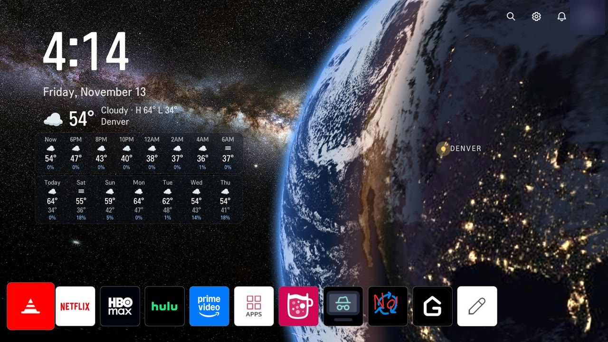
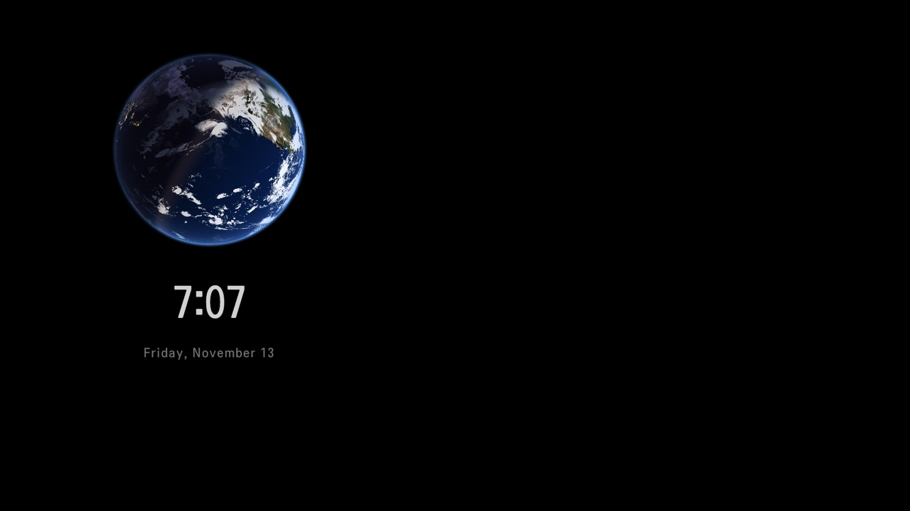

# Earthrise

Turn the home screen of a rooted LG TV into a clock and weather screen with a
live view of Earth behind it. It removes LG's ads and promos and replaces the
screensaver with a small spinning Earth.



> Not affiliated with LG. For a TV you own. No exploit code, no warranty. See
> [NOTICE.md](NOTICE.md).

## What you get

On webOS 7 (2022 models):

- **Clock and weather.** Big 12-hour clock, the date, current weather, the
  next 16 hours in 2-hour steps and a 7-day forecast.
- **A live Earth.** NASA's Blue Marble, lit by the real sun for the current
  minute, with city lights on the night side and clouds from NOAA's GOES-West
  satellite, refreshed every 15 minutes. A pin marks your town.
- **A cleaner home.** No ads, no LG Channels, no "Start a new experience"
  filler. Your apps sit in one row at the bottom. The input tiles (HDMI, Live
  TV, AirPlay) are small and wait below the screen until you press down.
- **A new screensaver.** A small spinning Earth with a quiet clock on black. It
  moves to a new spot every 30 seconds so nothing burns in.
- **Extras.** Rename an input (HDMI 1 to "PS5"). Reconnect a Bluetooth soundbar
  every time the TV turns on.

Everything runs on the TV. No computer, server or account is needed after
setup.



On webOS 4.5 and 6.x you get the cleanup and a full-screen photo background
(the patches stop at `07`). See [Tested TVs](#tested-tvs).

## Before you start

- **The TV is rooted** and you can SSH in as root. This repo starts after that.
  [`docs/01-rooting.md`](docs/01-rooting.md) links the public community tools.
- **Auto-updates are off.** An update can undo root. The rooting tools include
  an update blocker.
- **You have `git` and `ssh`** on your computer.

Replace `<tv-ip>` below with your TV's address. Run the commands from the repo
folder.

## Set it up (webOS 7)

**1. Make a copy of LG's home screen on the TV,** then pull it to your
computer. Make the copy on the TV, not on a Mac: LG's files include two whose
names differ only in letter case, and macOS keeps only one of them.

```sh
ssh root@<tv-ip> 'mkdir -p /var/lib/webosbrew/homeqml-k && cp -a /usr/palm/applications/com.webos.app.home/qml /var/lib/webosbrew/homeqml-k/'
mkdir stock-qml && ssh root@<tv-ip> 'tar -C /var/lib/webosbrew/homeqml-k/qml -cf - .' | tar -C stock-qml -xf -
```

**2. Apply the patches** to your local copy:

```sh
cd stock-qml
git init -q && git add -A && git -c user.name=me -c user.email=me@localhost commit -qm stock   # so you can see and undo every change
git apply ../patches/webos7/*.patch
```

`01`-`07` clean up the home screen, `08` drops LG Channels, `09` adds the
Earth clock, `10` moves the apps to the bottom, and `11` shrinks the input
tiles. Later patches build on earlier ones, so apply them in order. To leave
one out, run `git apply --check` on the ones after it first.

The space background behind the Earth comes with the repo:

```sh
cp ../assets/bg_space.jpg UserInterfaceLayer/Components/images/2k/bg_space.jpg
cp ../assets/bg_space.jpg UserInterfaceLayer/Components/images/4k/bg_space.jpg
```

**3. Set your town** in two places (paths from inside `stock-qml`):

- `UserInterfaceLayer/Containers/EarthClock.qml`: `homeLat`, `homeLon` and
  `homeName` (the pin and its label).
- `../scripts/earthfetch-k.sh`: `LAT` and `LON` (the weather).

**4. Push the changed files and install the hooks.** Send back only the files
the patches touched, so the copy on the TV keeps both of those files.

```sh
# still inside stock-qml from step 2
(git diff --name-only HEAD; git ls-files --others --exclude-standard) \
  | tar -cf - -T - | ssh root@<tv-ip> 'tar -C /var/lib/webosbrew/homeqml-k/qml -xf -'
cd ..
for f in hooks/70-homeqml-k hooks/81-earthclock-k; do
  ssh root@<tv-ip> "cat > /var/lib/webosbrew/init.d/${f#hooks/}" < $f
done
ssh root@<tv-ip> 'cat > /var/lib/webosbrew/earthfetch-k.sh' < scripts/earthfetch-k.sh
ssh root@<tv-ip> 'cd /var/lib/webosbrew && chmod 755 earthfetch-k.sh init.d/*-k && sh init.d/81-earthclock-k && sh init.d/70-homeqml-k'
```

The home screen restarts with the clock right away. The Earth and weather
appear about a minute later, once the first download finishes.

**5. The screensaver** (optional). It draws its Earth from the pictures the
weather fetcher from step 4 downloads, so it needs that installed. Same idea as
before: copy LG's screensaver on the TV, patch its clock file, send it back and
install the hook.

```sh
ssh root@<tv-ip> 'mkdir -p /var/lib/webosbrew/screensaver-k && cp -a /usr/palm/applications/com.webos.app.screensaver/qml /var/lib/webosbrew/screensaver-k/'
F=UserInterfaceLayer/Containers/Clock.qml
mkdir -p ss/$(dirname $F)
ssh root@<tv-ip> "cat /var/lib/webosbrew/screensaver-k/qml/$F" > ss/$F
git apply --directory=ss patches/webos7/screensaver/01-live-earth-screensaver.patch
ssh root@<tv-ip> "cat > /var/lib/webosbrew/screensaver-k/qml/$F" < ss/$F
ssh root@<tv-ip> 'cat > /var/lib/webosbrew/init.d/72-screensaver-k' < hooks/72-screensaver-k
ssh root@<tv-ip> 'chmod 755 /var/lib/webosbrew/init.d/72-screensaver-k && sh /var/lib/webosbrew/init.d/72-screensaver-k'
```

Reboot the TV once so a screensaver that already ran picks up the new file.
After that it shows whenever the TV sits idle on the home screen.

**6. Extras** (optional):

```sh
# rename an input; the new name shows everywhere
ssh -tt root@<tv-ip> "luna-send -n 1 luna://com.webos.service.eim/setDeviceInfo '{\"id\":\"HDMI_1\",\"label\":\"PS5\"}'"
```

For the soundbar, set `BAR` in `scripts/soundbar-k.sh` to your soundbar's
Bluetooth address, then install it the same way as the weather fetcher: the
script goes in `/var/lib/webosbrew/`, `hooks/80-soundbar-k` in `init.d/`. To
find the address:

```sh
ssh -tt root@<tv-ip> "luna-send -n 1 -f luna://com.webos.service.bluetooth2/device/getStatus '{}'"
```

The full details, including how the Earth is drawn, the data sources and their
credits, are in
[`docs/09-earth-clock-and-layout.md`](docs/09-earth-clock-and-layout.md).

## Undo

- **Home screen:** delete `/var/lib/webosbrew/init.d/70-homeqml-k` and reboot.
  The stock home screen comes back.
- **Screensaver:** delete `init.d/72-screensaver-k` and reboot.
- **Weather and soundbar:** delete `init.d/81-earthclock-k` and
  `init.d/80-soundbar-k`, then reboot.

Nothing in LG's own files changes. The hooks lay a copy over them at every
boot, and without the hook the copy is ignored.

## How it works

LG's home screen is a QML app on a read-only partition. You can't edit it in
place, but you can mount an edited copy on top of it. A boot hook redoes the
mount on every power-on and restarts the home app from the copy.

One catch: webOS restores the home app from a saved memory snapshot, so your
edits stay invisible until the hook deletes that snapshot.
[`docs/02-how-the-home-app-works.md`](docs/02-how-the-home-app-works.md)
explains it.

The Earth is drawn on the TV's GPU by a small shader in one 400-line QML file.
It uses about 30 MB of video memory.

## Tested TVs

| Model | webOS | Firmware | Patches | Notes |
|-------|-------|----------|---------|-------|
| 43UQ7070ZUD (2022) | 7.6 | 04.60.90 | `patches/webos7/` | Everything above. See [`docs/06-webos7.md`](docs/06-webos7.md) and [`docs/09`](docs/09-earth-clock-and-layout.md) |
| 43UP8000PUR (2021) | 6.5 | 03.51.16 | `patches/` | Cleanup and photo background. The original set |
| 43UP8000PUR (2021) | 6.5.3 | 03.53.45 | `patches/webos6-03.53/` | Same as above, newer firmware. See [`docs/07`](docs/07-webos6-03.53.md) |
| 32LM577BPUA (2019) | 4.5 | 05.40.97 | `patches/webos4.5/` | Uses a different home app and its own hook. See [`docs/08`](docs/08-webos4.5.md) |

Other models use the same home app, but file names and image sizes vary, so
check your own files before applying a patch.

On webOS 4.5 and 6.x, apply that folder's patches the same way and follow the
doc linked in the table. webOS 4.5 uses its own hook in `hooks/webos4.5/`.

## More docs

- [`docs/03-the-edits.md`](docs/03-the-edits.md): every cleanup patch, what it
  changes and why
- [`docs/04-going-further.md`](docs/04-going-further.md): your own apps and
  running several TVs
- [`docs/05-apps-and-settings.md`](docs/05-apps-and-settings.md): the homebrew
  apps worth installing, and the privacy settings

## Credits

- Milky Way background: ESO/S. Brunier, CC BY 4.0
- Day map and night lights: NASA EOSDIS GIBS (Blue Marble Next Generation,
  VIIRS Black Marble)
- Live clouds: NOAA/NESDIS STAR, GOES-West GeoColor
- Weather: [Open-Meteo.com](https://open-meteo.com), CC BY 4.0

## Safety

- This changes the screens of your own TV. Nothing here touches anyone else's
  device.
- A bad QML edit can leave the home screen black. Delete the hook and reboot to
  get the stock one back.
- These TVs have 1 to 1.3 GB of RAM. Keep images at LG's sizes.
