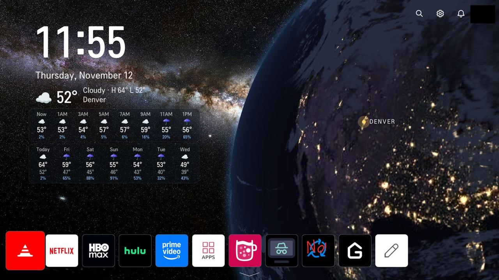

# Live Earth clock, bottom app row and a new screensaver (webOS 7)

This round turns the webOS 7 home into a clock and weather screen. The app row
moves to the bottom, and the space photo gets a live Earth in front of it. It's
five patches on top of the webOS 7 set, three boot hooks and two scripts.
Tested on the 43UQ7070ZUD (webOS 7.6, 1.3 GB RAM).



The screenshot uses a sample city. Set your own in the two places listed under
[Setup](#setup).

## What's on screen

- **Clock and date**, 12-hour, top left.
- **Weather now**, with today's high and low.
- **Next 16 hours** in 2-hour steps: icon, temperature, chance of rain.
- **7-day forecast**: icon, high, low, chance of rain.
- **The Earth**, seen from about 7,600 km up, east of home, with a pin on home.
  By default the land is NASA's Blue Marble map, lit by the real sun for the
  current minute. City lights show on the night side. Clouds come from NOAA's
  live GOES-West picture. Dawn and dusk sweep across the globe in real time.
- **App row at the bottom.** The input tiles (AirPlay, Live TV, HDMI, Sound
  Out, Remote PC) sit below the screen. Press down and both rows slide up.
- **Smaller input tiles**: app-icon height, name only.

## The patches (`patches/webos7/`)

| Patch | What it does |
|-------|--------------|
| `08-step-f-no-LG-Channels-tile` | `addLGChannelsItem()` returns early, so LG Channels no longer shows up on the inputs row |
| `09-step-g-earth-clock-and-weather` | Adds `EarthClock.qml` and places it in `MainView.qml`, above the space background |
| `10-step-h-app-row-at-the-bottom` | `getHomeAppListAreaYPosition()` pins the app row to the bottom. The inputs row sits below it. When the inputs row has focus, the app row slides up to make room |
| `11-step-i-compact-input-tiles` | `homeConnectWidth`/`homeConnectHeight` go from 309x192 to 210x126, and the second line under each tile name is hidden |
| `screensaver/01-live-earth-screensaver` | Replaces LG's analog clock screensaver. See [The screensaver](#the-screensaver) |

Why `10` works this way: with only the apps and one other shelf, the home app
counts as the "default shelf list" (`isDefaultShelfList` is true), and its
app-to-list transitions are switched off. So the patch moves the rows itself,
driven by `shelfList.activeFocus`, instead of relying on those transitions.

To rename an input (HDMI 1 to PS5, say), no patch is needed. The TV's own input
service does it, and the name shows everywhere:

```sh
luna-send -n 1 luna://com.webos.service.eim/setDeviceInfo '{"id":"HDMI_1","label":"PS5"}'
```

## How the Earth is drawn

`EarthClock.qml` is plain QML plus one GLSL `ShaderEffect`. The shader traces a
ray from a virtual camera for each pixel, hits a unit sphere, turns the hit
point into latitude and longitude, and looks up the textures. It has
`layer.enabled: true`, so the GPU draws the globe once and redraws it only when
an input changes (a new picture, the sun moving), not on every frame.

Two styles, set with `style` at the top of `EarthClock.qml`:

- `"pretty"` (default). NASA's day map and night lights, blended by the real
  sun angle. The sun position comes from NOAA's low-precision formula, which
  is accurate to a fraction of a degree. Clouds come from the GeoColor picture:
  anything whitish and unsaturated counts as cloud, and city lights and bare
  land don't. Snow reads as cloud too, which looks about right from orbit.
- `"geocolor"`. NOAA's GOES-West GeoColor picture as it comes: true color by
  day and an infrared night view with city lights after dark. Crisper storm
  detail, less pretty.

The camera is set relative to home (`camLat`, `camLon`, `camAlt`, `fovDeg` and
`homeOnScreen`). The defaults put the planet's edge down the middle of the
screen, so the right half is Earth and the left half stays space.

GOES-West only sees the Pacific side of the planet, roughly from New Zealand to
the US East Coast. Outside that, `"pretty"` shows no clouds and `"geocolor"`
fades to night. For homes outside the Americas and the Pacific, change the
picture to a satellite that covers you. NOAA's GOES-East covers the Atlantic.

## Data sources

| What | From | How often | Size |
|------|------|-----------|------|
| GeoColor full disk, 1808x1808 | NOAA STAR (`cdn.star.nesdis.noaa.gov`), public domain | every 15 min | ~1.7 MB |
| Day map, night lights, 2048x1024 | NASA GIBS (Blue Marble NG, VIIRS Black Marble) | once | ~0.3 MB |
| Weather (now, hourly, 8 days) | [Open-Meteo](https://open-meteo.com), CC BY 4.0, free for non-commercial use | every 15 min | ~7 KB |

Each download goes to a temporary file first. It's kept only if the size is
sane (capped with `curl --max-filesize`) and it really is a JPEG or the
expected JSON, so a bad download never replaces a good file. A second copy of
the script exits right away.

That's about 160 MB a day of downloads, almost all of it the satellite picture.
On a metered connection, raise the `sleep` in `earthfetch-k.sh`. The satellite
picture only changes every 10 minutes anyway.

The TV sends its location to Open-Meteo (the coordinates you set) and its IP
address to all three services. Nothing else leaves the TV.

Credits: satellite imagery from NOAA/NESDIS STAR (GOES-West GeoColor). Day map
and night lights from NASA EOSDIS GIBS (Blue Marble Next Generation, VIIRS
Black Marble). Weather data by [Open-Meteo.com](https://open-meteo.com)
(CC BY 4.0).

## Memory

The textures in use are the 1808x1808 picture plus two 2048x1024 maps. That's
about 30 MB of GPU memory. The home app was fine with it on a 1.3 GB TV that
has around 430 MB free after boot. The fetcher is one shell loop calling
`curl`.

## Setup

1. Apply the patches (on top of `patches/webos7/01` to `07`) as in the
   [quick start](../README.md#quick-start-tv-already-rooted-ssh-reachable).
2. Set home in two places:
   - `scripts/earthfetch-k.sh`: `LAT` and `LON`, used for the weather.
   - `EarthClock.qml`: `homeLat`, `homeLon` and `homeName`, used for the pin
     and the label.
3. Copy the scripts and hooks to the TV:

   ```sh
   scp scripts/earthfetch-k.sh root@TV:/var/lib/webosbrew/
   scp hooks/81-earthclock-k hooks/72-screensaver-k root@TV:/var/lib/webosbrew/init.d/
   ssh root@TV 'chmod 755 /var/lib/webosbrew/earthfetch-k.sh /var/lib/webosbrew/init.d/*-k'
   ```

4. Copy the screensaver QML into place once (see below), then reboot, or run
   the hooks by hand.

The first fetch takes about a minute. Until then the clock and weather boxes
are hidden and the plain space photo shows.

## The screensaver

LG's screensaver (`com.webos.app.screensaver`) is a separate QML app with the
same structure as home. The patch rewrites its `Clock.qml`. It keeps the parts
`MainView.qml` calls (`playing`, `dataReady`, `looped()` and `animation`) and
draws a small live Earth over a black screen, using the pretty style and the
same files the home fetcher keeps fresh, with a quiet clock and date under it.
Every loop (about 30 seconds) the screensaver reloads it, and it moves to a new
random spot, so nothing sits still on the panel.

`hooks/72-screensaver-k` bind-mounts a patched copy over the stock one, the same
trick as the home overlay:

```sh
ssh root@TV 'mkdir -p /var/lib/webosbrew/screensaver-k && cp -a /usr/palm/applications/com.webos.app.screensaver/qml /var/lib/webosbrew/screensaver-k/'
# then apply patches/webos7/screensaver/01-live-earth-screensaver.patch inside that copy
```

The screensaver only starts when the TV is idle with the screen on. Launching
it by hand with `applicationManager/launch` returns success, but nothing shows.
Status: installed on the test TV, not yet seen running on screen.

## Soundbar that won't stay connected

If a Bluetooth soundbar drops after every power cycle, `scripts/soundbar-k.sh`
fixes it. It subscribes to `tvpower/getPowerState`. On every power-on, from
standby or a cold boot, it reconnects the soundbar's A2DP and sets the sound
output to `bt_soundbar`. If the soundbar is off, it leaves the TV speakers
alone. Waking from the screensaver doesn't count as a power-on, so a manual
switch back to the TV speakers sticks until the next power-on. Set `BAR` to
your soundbar's address:

```sh
luna-send -n 1 -f luna://com.webos.service.bluetooth2/device/getStatus '{}'   # lists paired devices
```

`hooks/80-soundbar-k` starts it at boot.

## Screenshots

`captureCompositorOutput` works on webOS 7, and it still works with the panel
switched off. That's handy for working late without lighting up the room:

```sh
luna-send -n 1 luna://com.webos.service.tvpower/power/turnOffScreen '{"standbyMode":"active"}'
luna-send -n 1 luna://com.webos.surfacemanager/captureCompositorOutput '{"output":"/tmp/home.png","format":"PNG"}'
```

The capture service's `SCREEN` method misses the Earth clock entirely. Use the
compositor capture instead. Give the home app about
30 seconds after a relaunch before capturing, or you get a black frame.

## Rolling back

- Home: restore the stock QML copy (or `git checkout` the overlay) and run
  `init.d/70-homeqml-k`.
- Screensaver: delete `init.d/72-screensaver-k`, then
  `umount /usr/palm/applications/com.webos.app.screensaver/qml`.
- Fetcher and soundbar: delete their hooks and kill the scripts. Match the
  exact script path, because a pattern can match your own SSH shell.
